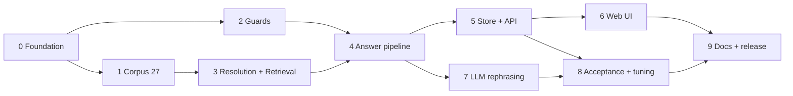

# BoloSIP: Phase-wise Implementation Plan

> **Facts-only. No investment advice.**

Version 1.2 · 16 Nov 2026 · Builds what [architecture.md](architecture.md) v1.2 describes, to meet [problem_statement.md](problem_statement.md) v2.2 · LLM provider: **Groq**

---

## 1. How to read this plan

The build is split into **10 phases (0–9)**. Each phase ends in something that runs and is tested, and is committed and pushed to GitHub before the next phase starts.

Every phase lists:

- **Goal:** what is true when the phase is done
- **Tasks:** the work, in order
- **Files:** what gets created or changed
- **Exit criteria:** the checks that must pass before moving on
- **Covers:** which acceptance criteria (AC, problem statement section 10) and architecture sections it delivers

Section references such as "arch §8" point to [architecture.md](architecture.md), and "PS §4.2" points to [problem_statement.md](problem_statement.md).

## 2. Current status (16 Nov 2026)

| Item | State |
|---|---|
| Problem statement v2.2, architecture v1.2, edge cases v1.2, eval v1.1 | Done |
| `ingest.py`: fetch with urllib → curl → snapshot, parse, 12 chunks per scheme | Works for **5 of 27** schemes |
| `data/official_docs.json`: 10 curated official notes | Done; needs one review pass |
| `data/corpus.json` + `data/raw/` snapshots | 5 schemes only |
| `bolosip/guards.py` | Draft, **untested** |
| **Phase 0: Foundation** | **Done** (16 Nov 2026): config, 13 smoke tests, eval runner; gate report `eval/reports/2026-11-16-phase0-8def061.md` |
| Everything else in arch §3 | Not started |

## 3. Phase overview

| Phase | Name | Main output | Depends on | Est. effort |
|---|---|---|---|---|
| 0 | Foundation | Package skeleton, config, test runner | — | 0.5 day |
| 1 | Corpus for 27 schemes | Validated `corpus.json` with scheme registry and aliases | 0 | 1.5 days |
| 2 | Guards | Tested personal-data, advice and returns checks | 0 | 1 day |
| 3 | Scheme resolution and retrieval | `schemes.py`, `retriever.py` with tuned thresholds | 1 | 1.5 days |
| 4 | Answer pipeline (extractive) | `composer.py`, `formatter.py`, `pipeline.py` returning `Reply` | 2, 3 | 1.5 days |
| 5 | Thread store and HTTP API | `store.py`, `server.py` | 4 | 1.5 days |
| 6 | Web UI | `web/index.html` | 5 | 1 day |
| 7 | Optional LLM rephrasing | `llm.py` + composer integration | 4 | 1 day |
| 8 | Acceptance suite and tuning | `test_acceptance.py` passing all 135 fact checks and AC 1–8 | 5, 7 | 1.5 days |
| 9 | Documentation and release | README, final docs, tagged release | 6, 8 | 0.5 day |
| | | | **Total** | **≈ 11.5 days** |

**Can run in parallel:** Phases 1 and 2. Phase 7 can run alongside Phases 5 and 6, since it only plugs into the composer.

**Milestones**

| Milestone | After phase | What you can demo |
|---|---|---|
| M1: Answers in the terminal | 4 | `python -m bolosip "expense ratio of hdfc mid cap"` prints a correct, cited, footed answer |
| M2: Working chat app | 6 | Browser chat with multiple threads, refusals and the disclaimer |
| M3: Accepted build | 8 | All automated acceptance checks green |
| M4: Release | 9 | README complete; tagged `v1.0` on GitHub |

---

## Phase 0: Foundation

**Goal:** an empty but runnable package, with one place for settings and a test command that works.

**Tasks**

1. Create `bolosip/__init__.py` and `bolosip/config.py`.
   - Read the variables in arch §16 (`BOLOSIP_HOST`, `BOLOSIP_PORT`, `BOLOSIP_DB`, `BOLOSIP_CORPUS`, `BOLOSIP_LLM`, `BOLOSIP_MODEL`).
   - Hold the tunable constants: BM25 `k1`/`b`, `W_SCHEME`, `W_TOPIC`, `W_OTHER`, `MIN_SCORE`, `MIN_LEXICAL`, LLM timeout.
   - Hold the fixed links: AMFI investor page, SEBI investor site, HDFC factsheet page.
2. Create `tests/__init__.py` and one smoke test, so `python -m unittest discover tests` runs.
3. Add `requirements.txt` listing only `groq`, marked optional in a comment.
4. Confirm `.gitignore` covers `__pycache__/`, `*.sqlite3`, `.env` and `graft/`.
5. Add a stub `README.md` with a one-paragraph description and the disclaimer.

**Files:** `bolosip/__init__.py`, `bolosip/config.py`, `tests/__init__.py`, `tests/test_smoke.py`, `requirements.txt`, `README.md`

**Exit criteria**
- [x] `python -m unittest discover tests` passes, with no third-party packages installed.
- [x] `python -c "import bolosip.config"` works with no environment variables set.

**Covers:** arch §4, §16

---

## Phase 1: Corpus for all 27 schemes

**Goal:** `data/corpus.json` holds a validated scheme registry and about 335 single-fact chunks for all 27 schemes, each with its source URL and date.

**Source URLs: these 27, and no others**

Ingestion fetches **exactly** the 27 Groww HDFC scheme pages listed in PS §3.1, copied below. No other URL is fetched: no extra Groww pages (peer funds, AMC page, category pages), no other aggregators, and no links found inside these pages. Adding or removing a URL requires a problem statement change first (§6 Working agreements).

| # | Scheme ID | Groww URL |
|---|---|---|
| 1 | `hdfc-large-cap` | https://groww.in/mutual-funds/hdfc-large-cap-fund-direct-growth |
| 2 | `hdfc-mid-cap` | https://groww.in/mutual-funds/hdfc-mid-cap-fund-direct-growth |
| 3 | `hdfc-small-cap` | https://groww.in/mutual-funds/hdfc-small-cap-fund-direct-growth |
| 4 | `hdfc-large-and-mid-cap` | https://groww.in/mutual-funds/hdfc-large-mid-cap-fund-direct-growth |
| 5 | `hdfc-multi-cap` | https://groww.in/mutual-funds/hdfc-multi-cap-fund-direct-growth |
| 6 | `hdfc-flexi-cap` | https://groww.in/mutual-funds/hdfc-equity-fund-direct-growth |
| 7 | `hdfc-focused` | https://groww.in/mutual-funds/hdfc-focused-fund-direct-growth |
| 8 | `hdfc-nifty-50-index` | https://groww.in/mutual-funds/hdfc-nifty-50-index-fund-direct-growth |
| 9 | `hdfc-bse-sensex-index` | https://groww.in/mutual-funds/hdfc-bse-sensex-index-fund-direct-growth |
| 10 | `hdfc-pharma-and-healthcare` | https://groww.in/mutual-funds/hdfc-pharma-and-healthcare-fund-direct-growth |
| 11 | `hdfc-technology` | https://groww.in/mutual-funds/hdfc-technology-fund-direct-growth |
| 12 | `hdfc-transportation-and-logistics` | https://groww.in/mutual-funds/hdfc-transportation-and-logistics-fund-direct-growth |
| 13 | `hdfc-defence` | https://groww.in/mutual-funds/hdfc-defence-fund-direct-growth |
| 14 | `hdfc-housing-opportunities` | https://groww.in/mutual-funds/hdfc-housing-opportunities-fund-direct-growth |
| 15 | `hdfc-business-cycle` | https://groww.in/mutual-funds/hdfc-business-cycle-fund-direct-growth |
| 16 | `hdfc-infrastructure` | https://groww.in/mutual-funds/hdfc-infrastructure-fund-direct-growth |
| 17 | `hdfc-balanced-advantage` | https://groww.in/mutual-funds/hdfc-balanced-advantage-fund-direct-growth |
| 18 | `hdfc-multi-asset-allocation` | https://groww.in/mutual-funds/hdfc-multi-asset-allocation-fund-direct-growth |
| 19 | `hdfc-equity-savings` | https://groww.in/mutual-funds/hdfc-equity-savings-fund-direct-growth |
| 20 | `hdfc-arbitrage` | https://groww.in/mutual-funds/hdfc-arbitrage-fund-direct-growth |
| 21 | `hdfc-overnight` | https://groww.in/mutual-funds/hdfc-overnight-fund-direct-growth |
| 22 | `hdfc-liquid` | https://groww.in/mutual-funds/hdfc-liquid-fund-direct-growth |
| 23 | `hdfc-money-market` | https://groww.in/mutual-funds/hdfc-money-market-fund-direct-growth |
| 24 | `hdfc-ultra-short-term` | https://groww.in/mutual-funds/hdfc-ultra-short-term-fund-direct-growth |
| 25 | `hdfc-banking-and-psu-debt` | https://groww.in/mutual-funds/hdfc-banking-and-psu-debt-fund-direct-growth |
| 26 | `hdfc-gilt` | https://groww.in/mutual-funds/hdfc-gilt-fund-direct-growth |
| 27 | `hdfc-silver-etf-fof` | https://groww.in/mutual-funds/hdfc-silver-etf-fof-direct-growth |

> The hand-curated notes in `data/official_docs.json` (HDFC MF, AMFI, SEBI, CAMS, MF Central) are **not fetched** by ingestion. They are typed in by hand, reviewed against their pages, and only cited as links (PS §3.2).

**Tasks**

1. **Scheme registry.** Replace the 5-entry `SCHEMES` dict in `ingest.py` with the 27 entries in the table above, using exactly those URLs and IDs. Each entry has `url`, `group` (Equity / Hybrid / Debt / FoF), `category` and `aliases`.
   - **URL allow-list check:** before fetching, `ingest.py` asserts the registry holds exactly these 27 URLs (no more, no fewer, no duplicates), and that `fetch()` is only ever called with a registry URL. Any other URL stops the run with exit code `2`.
   - IDs are slugs of the **current** name, e.g. `hdfc-flexi-cap` for the `hdfc-equity-fund` URL (arch §5.1).
   - Aliases cover short forms, spacing variants ("midcap", "mid-cap"), `&`/"and", and former names ("hdfc equity fund").
   - Shared ambiguous aliases (e.g. "hdfc equity") go under each scheme they could mean.
2. **Registry output.** Write `group`, `category`, `aliases` and `factsheet_url` into `corpus.json["schemes"]`.
3. **Chunk templates for debt and hybrid funds.** Check that all 12 topics read correctly for Liquid, Overnight, Arbitrage, Gilt and the index funds, e.g. graded exit loads and "Nil" exit load.
4. **Validation step** (arch §15). The script refuses to write if any check fails:
   - every registry scheme has all 12 topics
   - every chunk has ≤ 3 sentences and a non-empty `source_url` and `as_of`
   - expense ratio is between 0 and 3%; minimum SIP is a positive integer
   - riskometer is one of SEBI's 6 levels
   - no chunk text contains return, CAGR or performance figures
5. **Exit codes:** `0` all live, `1` some from snapshots, `2` some scheme missing. Old `corpus.json` stays on any failure.
6. **Riskometer from a fixed path (GAP-03).** Replace the first-match `"risk"` regex with a read from the scheme's own JSON object, cross-checked against `meta_desc`; fail on mismatch. Also check the parsed `search_id` and `isin` match the registry.
7. **Atomic write and lock (GAP-04).** Write `corpus.json.tmp`, validate, then `os.replace`; use `data/.ingest.lock` to stop two runs at once.
8. **Review `official_docs.json`.** Re-open each linked official page, confirm the text still matches, and update `reviewed_on`.
9. Run ingestion, read through the `corpus.json` diff by hand, and commit the 27 snapshots in `data/raw/`.

**Files:** `ingest.py`, `data/official_docs.json`, `data/corpus.json`, `data/raw/*.html` (27), `tests/test_ingest.py`

**Tests (`test_ingest.py`, offline, built from snapshots)**
- The registry's URL set equals the 27 URLs listed in `Doc/problem_statement.md` §3.1 (the test reads both, so the two can't drift apart); a registry with an extra or missing URL fails.
- Parser extracts the right fields from 3 sample snapshots: one equity, one debt, one FoF.
- Validation rejects a corpus with a missing topic, a 4-sentence chunk, or a riskometer outside SEBI's 6 levels.
- A snapshot whose first `"risk"` value belongs to a peer fund still yields the scheme's own riskometer (GAP-03).
- An exception raised mid-write leaves the previous `corpus.json` byte-for-byte unchanged (GAP-04).
- No chunk contains `%` next to "return", "CAGR" or "1Y/3Y/5Y".

**Exit criteria**
- [ ] `python ingest.py` exits `0` (or `1` with a clear snapshot warning), and the registry has 27 schemes.
- [ ] The set of URLs fetched in the run equals the 27 URLs in the table above, and every scheme chunk's `source_url` is one of them.
- [ ] Chunk count is between 330 and 340.
- [ ] Spot-check 10 random scheme facts against the live pages; all match.
- [ ] `test_ingest.py` passes.

**Covers:** AC 1 (data side), AC 3 (source URLs); arch §5.1, §5.2, §15; PS §3.1, §3.2, §8

---

## Phase 2: Guards

**Goal:** the personal-data, advice and returns checks are correct, tested, and tuned toward refusing when unsure.

**Tasks**

1. Review the draft `bolosip/guards.py` against arch §11.
2. Write `tests/test_guards.py` with a table of cases for each guard:
   - **Personal data, must match:** a sample PAN (`ABCDE1234F`), a 12-digit Aadhaar with and without spaces, an email address, `+91 98xxxxxxxx` / `98xxx xxxxx`, "OTP is 482913", "folio no 1234567/89", a 14-digit account number, an IFSC code such as `HDFC0001234` (GAP-07).
   - **Personal data, must not match:** "account statement", "₹1,00,687 crore", "NIFTY 50", "0.73%", "launched 01-Jan-2013", ISIN `INF179K01XQ0`.
   - **Advice, must match (at least 15):** "should I invest", "which is better", "mid cap vs small cap", "is it safe", "best HDFC fund", "recommend a fund", "will NAV go up", "good for retirement", "how much should I invest", "compare…".
   - **Advice, must not match:** "BSE Sensex index fund", "what is the benchmark", "exit load on liquid fund", "minimum SIP".
   - **Returns, must match:** "3 year returns", "CAGR", "how much did it grow", "if I invest 10000", "SIP calculator", "performance last year".
   - **Returns, must not match:** "capital gains statement", "download tax statement".
3. Fix every failure. Check order: personal data → advice → returns, so "which fund gave better returns" gets the advice refusal.
4. `redact()` must replace every detected value and leave the rest of the sentence readable.
5. Confirm public scheme identifiers are *not* treated as personal data: ISINs (e.g. `INF179K01XQ0`), scheme codes and RTA codes must pass through unredacted.

**Files:** `bolosip/guards.py`, `tests/test_guards.py`

**Exit criteria**
- [ ] All cases in `test_guards.py` pass, with at least 60 cases in total.
- [ ] No regex takes more than 5 ms on a 500-character input (no catastrophic backtracking).

**Covers:** AC 4, 5, 6 (detection side); arch §11; PS §4.2 rules 1–3, §7

---

## Phase 3: Scheme resolution and retrieval

**Goal:** a question maps to the right scheme (or a clear "which one?"), and to the right chunk with a score the pipeline can trust.

**Tasks**

1. **`bolosip/schemes.py`** (arch §7):
   - `normalise(text)`: lowercase; `&` → "and"; hyphens → spaces; collapse spaces.
   - `resolve(text, last_scheme, topic) -> Resolution`: returns `one(scheme_id)`, `ambiguous([ids])`, `multiple([ids])` or `none`.
   - Longest alias match first, so "large and mid cap" doesn't also match "large cap" and "mid cap".
   - Fall back to the thread's `last_scheme` only for scheme-specific topics.
   - **Other fund house check (GAP-01):** before alias matching, if the message names another AMC (list in `config.py`) and not HDFC, return `other_amc` so the pipeline replies `not_found`.
2. **`bolosip/retriever.py`** (arch §8):
   - Tokeniser plus a short stop-word list.
   - BM25 index built once from `text + keywords`.
   - Topic detection using the per-topic keyword lexicon from `ingest.py` (move the lexicon to `config.py`, or a shared module, so ingest and retrieval use one copy).
   - `search(query, scheme_id, topic) -> list[Hit]`, with `Hit(chunk, score, lexical_score)` and the scheme and topic boosts.
3. **`tests/test_retrieval.py`:**
   - Topic detection for each of the 12 scheme topics and 9 official topics.
   - Each row of the confusable-groups table (arch §7) has a test: "HDFC Equity" → ambiguous, "HDFC Equity Fund" → Flexi Cap, "large cap index" → ambiguous (NIFTY 50 / Sensex), "multi" → ambiguous.
   - Follow-up: `resolve("what about its exit load", last_scheme="hdfc-mid-cap")` → mid cap.
   - Out-of-corpus: "expense ratio of SBI Bluechip" → below threshold.
   - Other AMC with a matching alias (GAP-01): "SBI Small Cap exit load", "Axis Midcap TER", "Nippon India Multi Cap" → `other_amc`, never an HDFC scheme.
4. **First pass at thresholds:** set `MIN_SCORE` and `MIN_LEXICAL` so every test above passes. Final tuning happens in Phase 8.

**Files:** `bolosip/schemes.py`, `bolosip/retriever.py`, `bolosip/config.py`, `tests/test_retrieval.py`

**Exit criteria**
- [ ] For all 27 schemes, the question "<short name> expense ratio" returns that scheme's `expense_ratio` chunk as the top hit.
- [ ] Every confusable-group test gives a clarification, never a silent guess.
- [ ] Out-of-corpus questions score below the threshold.
- [ ] Index build takes < 200 ms and a search < 5 ms.

**Covers:** AC 1 (retrieval side), AC 7a, AC 8; arch §7, §8

---

## Phase 4: Answer pipeline (extractive)

**Goal:** a single function turns any message plus thread context into a valid `Reply`, with no LLM involved. **Milestone M1.**

**Tasks**

1. **`Reply` dataclass:** `kind`, `text`, `source{url,name}`, `footer`, `scheme_id`, `candidates` (arch §6.2), with a `to_dict()` for JSON. Kinds include `help` (GAP-02).
2. **`bolosip/formatter.py`** (arch §10):
   - Strip URLs from the body; split sentences without breaking decimals or `₹`; keep at most 3.
   - Attach the source and the `Last updated from sources: <as_of>` footer.
   - `validate(reply)`: 1–3 sentences, exactly one URL across body + source, footer present.
3. **`bolosip/composer.py`:** extractive mode returns the top chunk's text unchanged. Leave a clear hook for the LLM (Phase 7).
4. **Fixed replies** for `refusal`, `performance`, `privacy`, `clarify`, `help` and `not_found`, using the wording in PS §4.2 and the links and dates in arch §10.1.
   - `performance` links the scheme's factsheet if one is resolved, otherwise the general HDFC factsheet page.
   - `clarify` lists at most 5 candidate scheme names. If no scheme was named at all, it asks the user to name one, giving 3 examples.
   - ELSS questions: the answer includes "none of the covered schemes is ELSS" (PS §3.1).
   - `help` (GAP-02): greetings, "what can you do?" and messages with no meaningful words get the welcome text plus the 3 examples; no link, no footer. Checked after the three guards.
   - Plan variants (GAP-05): "regular", "IDCW", "dividend" or "payout" with a variant-specific topic (`expense_ratio`, `nav`, `aum`, `scheme_details`) → `not_found` saying only Direct Growth is covered; with a shared topic → normal answer prefixed "For the Direct Growth plan: ".
5. **`bolosip/pipeline.py`:** `handle(text, ctx) -> (Reply, new_ctx)`, running rules 1–6 in order (arch §6). `ctx` holds only `last_scheme`.
6. **CLI for M1:** `python -m bolosip "<question>"` prints the reply.
7. **`tests/test_format.py`:** sentence-splitting edge cases ("0.73%", "₹1,00,687.07", "Rs. 100", "e.g."), single-URL enforcement, footer present, `validate()` passes for every chunk in the corpus.
8. **`tests/test_pipeline.py`:** one test per reply kind, plus a check that rules fire in order.

**Files:** `bolosip/formatter.py`, `bolosip/composer.py`, `bolosip/pipeline.py`, `bolosip/__main__.py`, `tests/test_format.py`, `tests/test_pipeline.py`

**Exit criteria**
- [ ] `validate()` passes for **every** chunk in `corpus.json` used as an answer.
- [ ] Each of the 7 reply kinds is produced by at least one test and has the right link (none for `clarify` and `help`).
- [ ] M1 demo works for the 3 UI example questions plus one refusal and one returns question.

**Covers:** AC 2, 3, 4, 5, 8; arch §6, §9.1, §10; PS §4

---

## Phase 5: Thread store and HTTP API

**Goal:** a local server that keeps several independent conversations and answers over JSON.

**Tasks**

1. **`bolosip/store.py`:**
   - SQLite schema from arch §5.3, WAL mode, foreign keys on.
   - One connection per call; a user message and its reply are written in one transaction.
   - Functions: `create_thread`, `list_threads`, `get_messages`, `add_exchange(thread_id, user_text_redacted, reply, new_last_scheme)`, `delete_thread`, `get_ctx`.
   - Thread title = first question, **redacted**, cut to 60 characters.
2. **`server.py`:** `ThreadingHTTPServer` with the routes in arch §13.
   - Input limits: body ≤ 4 KB, text 1–500 characters, UUID check on thread IDs → `400` otherwise. Unknown thread → `404`.
   - Bind to `127.0.0.1` by default.
   - Request logs show method, path, status and time only, never message text (arch §17).
   - **Origin checks (GAP-08):** `Host` must be localhost / `127.0.0.1` / the configured host (else `403`); a foreign `Origin` on `POST`/`DELETE` → `403`; `POST` without `Content-Type: application/json` → `415`; no CORS headers.
   - **Rate limit (GAP-09):** per-IP token bucket, 30 messages and 120 requests per minute by default (`BOLOSIP_RATE_MSG`, `BOLOSIP_RATE_ALL`); over the limit → `429` with `Retry-After`.
3. The user message is **always** redacted before it reaches `store.py`. Write a test that inspects the database file directly.
4. **`tests/test_threads.py`** (integration, server on a random port):
   - Two threads interleaved: A asks about Mid Cap, B about Liquid; then both ask "what is its exit load?" → each gets its own scheme.
   - 20 parallel requests across 5 threads: no errors, and each thread's history is correct and in order.
   - A message containing a PAN → privacy reply; the database holds `[redacted]` and no PAN anywhere.
   - Deleting a thread removes its messages.
   - `test_api.py`: wrong `Host` → `403`; `Origin: https://evil.example` on POST → `403`; `text/plain` POST → `415`; 31st message in a minute → `429`.

**Files:** `bolosip/store.py`, `server.py`, `tests/test_threads.py`, `tests/test_api.py`

**Exit criteria**
- [ ] `python server.py` starts, and `/api/health` reports 27 schemes.
- [ ] `test_threads.py` and `test_api.py` pass.
- [ ] Searching the SQLite file for every sample personal-data value from Phase 2 finds nothing.

**Covers:** AC 6, 7; arch §5.3, §12, §13, §17; PS §6, §7

---

## Phase 6: Web UI

**Goal:** the minimal chat page from PS §5 and arch §14. **Milestone M2.**

**Tasks**

1. `web/index.html` as one file: inline CSS and JS, no external scripts, fonts or trackers.
2. **Sticky header** with "BoloSIP" and **"Facts-only. No investment advice."**
3. **Welcome panel** with 3 clickable examples (from `/api/config`):
   - "What is the expense ratio of HDFC Mid Cap Fund?"
   - "What is the ELSS lock-in period?"
   - "How do I download my account statement?"
4. **Thread sidebar:** new, switch, delete; newest first. Becomes a drawer below 700 px.
5. **Message rendering:**
   - Text via `textContent` only.
   - Source as a link with `target="_blank" rel="noopener noreferrer"`.
   - Footer line, and a different style per `kind` (e.g. refusals in a neutral info style).
   - `clarify` replies show candidate schemes as buttons that send "<scheme name> <original topic>".
6. **Input:** 500-character limit with a counter; the send button is disabled while a reply is pending in that thread; a hint under the input: "Don't share PAN, Aadhaar, phone or OTP."
7. Remember the active thread in `localStorage`, wrapped in try/catch.
8. Accessibility: labelled input, keyboard-reachable buttons, contrast-checked colours, `aria-live="polite"` on the message list.
9. Manual check in Chrome and Edge, at desktop and 375 px widths.

**Files:** `web/index.html`, small additions to `server.py` (`/api/config`)

**Exit criteria**
- [ ] Welcome message, 3 examples and the disclaimer are visible on first load (AC 9).
- [ ] Clicking each example gives a correct, cited, footed answer.
- [ ] Two browser tabs on different threads don't interfere.
- [ ] Pasting `` as a question shows it as plain text.
- [ ] No horizontal scrolling at 375 px.

**Covers:** AC 9; arch §14; PS §5

---

## Phase 7: Optional LLM rephrasing

**Goal:** when credentials are available, answers can be reworded to fit the question. Facts, links and limits stay exactly as in extractive mode.

**Tasks**

1. **`bolosip/llm.py`:** create the Groq client (`from groq import Groq`; `Groq(timeout=15.0, max_retries=1)`) once, lazily, and only if the `groq` package is installed, `GROQ_API_KEY` is set, and `BOLOSIP_LLM` is not `off`.
   - `client.chat.completions.create(model=config.MODEL, messages=[system, user], temperature=0, max_completion_tokens=200)`; default model `llama-3.3-70b-versatile`.
   - `rephrase(question, chunk_text) -> str | None`; returns `None` on **any** exception, a `finish_reason` other than `stop`, empty text, or `NOT_IN_SOURCE`.
2. **System prompt** (arch §9.2): answer only from the given text, ≤ 3 sentences, no new facts, numbers, opinions, advice, comparisons or URLs; reply `NOT_IN_SOURCE` if the text doesn't answer.
3. **Output checks** in `composer.py` (arch §9.2):
   - every number in the output also appears in the chunk text, after normalising (GAP-06): remove ₹/Rs/INR and thousands separators, drop trailing decimal zeros, map number words one to twelve to digits, parse dates
   - no URL in the output
   - `is_advisory(output)` is false
   - `formatter.validate()` passes

   Any failure → use the extractive text.
4. Only `answer` replies go through the LLM. Personal-data, refusal, performance, clarify and not-found replies never do.
5. **Tests:**
   - A stub LLM returns crafted outputs: an extra number, a URL, "you should invest", 5 sentences, an exception. Every case must fall back to extractive.
   - Reformatted but equal numbers are **accepted** (GAP-06): "₹100687.07" for "₹1,00,687.07", "one year" for "1 year", "0.730%" for "0.73%".
   - An optional live test, `@skipUnless(credentials)`, rephrases 10 real questions, checks they pass the output checks, and logs the fallback rate.
6. `/api/health` shows `llm_enabled`.

**Files:** `bolosip/llm.py`, `bolosip/composer.py`, `tests/test_llm.py`, `requirements.txt`

**Exit criteria**
- [ ] With the `groq` SDK uninstalled, everything still works and all other tests pass.
- [ ] Every stub case falls back correctly.
- [ ] The live test (if run) shows 0 invented numbers and 0 URLs in accepted outputs.

**Covers:** arch §9.2, §17 (prompt injection); PS §11 (LLM optional)

---

## Phase 8: Acceptance suite and tuning

**Goal:** one command proves every acceptance criterion. **Milestone M3.**

**Tasks**

1. **`tests/test_acceptance.py`**, built from `corpus.json` and the `data/raw` snapshots (offline):

   | AC | Test |
   |---|---|
   | 1 | 135 fact checks: for each of the 27 schemes × {expense ratio, exit load, minimum SIP, riskometer, benchmark}, ask a natural question and check the answer contains the value parsed straight from that scheme's snapshot. |
   | 2 | Every reply produced in this file has 1–3 sentences, exactly one URL and the footer. `clarify` replies are checked separately: no URL, no facts. |
   | 3 | Every cited URL is in the allowed list: the 27 scheme pages + hdfcfund.com + amfiindia.com + sebi.gov.in + camsonline.com + mfcentral.com. |
   | 4 | At least 15 advice phrasings → `refusal` with an AMFI or SEBI link. |
   | 5 | At least 8 returns phrasings → `performance` with the factsheet link and no `%` figures. |
   | 6 | Sample personal data in 5 forms → `privacy`, and the stored text is redacted (through the API). |
   | 7 | Interleaved threads give correct follow-ups. |
   | 7a | Ambiguous names → `clarify`; "HDFC Equity Fund" → Flexi Cap. |
   | 8 | At least 10 out-of-corpus questions (other AMCs, crypto, stocks) → `not_found`. |

2. **Paraphrase set:** for each of the 9 question types in PS §3.3, write 3 ways of asking (e.g. "TER", "annual charges", "how much does it cost per year"). Add keywords until every paraphrase passes.
3. **Tune the weights and thresholds** in `config.py` against this suite. Record the final values and the pass rate in a comment.
4. **Regression guard:** a CI-style script (`scripts/check.ps1` and `scripts/check.sh`) runs ingestion validation (offline mode) and then all tests.

**Files:** `tests/test_acceptance.py`, `tests/paraphrases.json`, `bolosip/config.py`, `ingest.py` (`--offline` flag), `scripts/check.*`

**Exit criteria**
- [ ] `python -m unittest discover tests` passes **100%** offline, with no LLM.
- [ ] All 135 fact checks pass.
- [ ] 0 advice questions answered; 0 personal-data values stored; 0 answers without exactly one link.

**Covers:** AC 1–8; arch §18; PS §10

---

## Phase 9: Documentation and release

**Goal:** someone new can set up, run and understand BoloSIP from the README alone. **Milestone M4.**

**Tasks**

1. **`README.md`** (PS §9):
   - What BoloSIP is, plus the **"Facts-only. No investment advice."** snippet
   - Setup: Python version, optional `pip install groq`, `GROQ_API_KEY`
   - Run: `python ingest.py`, `python server.py`, `python -m unittest discover tests`
   - Selected AMC and the 27 schemes (link to PS §3.1)
   - Architecture overview: a short version of arch §2–§3 with one diagram, linking to the full doc
   - Known limitations: the Groww source exception, freshness, lexical retrieval, English only (arch §20)
   - Manual UI checklist (AC 9)
2. Update the **Status** column in arch §3 to "Built", and fix anything that changed during the build.
3. Bump `problem_statement.md` / `architecture.md` versions if they changed; regenerate `problem_statement.txt`.
4. Final full run: `python ingest.py` (live), review the diff, run all tests, do the manual UI check.
5. Commit, push, and tag `v1.0`; create a GitHub release with the README summary.

**Files:** `README.md`, `Doc/architecture.md`, `Doc/problem_statement.*`

**Exit criteria**
- [ ] A fresh clone, set up by following only the README, runs the server and passes all tests.
- [ ] Every deliverable in PS §9 is present.
- [ ] `v1.0` tag and release visible on GitHub.

**Covers:** PS §9 deliverables 1–4

---

## 4. Traceability: acceptance criteria → phases

| AC | Criterion | Built in | Proven in |
|---|---|---|---|
| 1 | Correct facts | 1, 3 | 8 |
| 2 | Answer format | 4 | 4, 8 |
| 3 | Valid citations | 1, 4 | 8 |
| 4 | Refusals | 2, 4 | 2, 8 |
| 5 | Performance handling | 2, 4 | 2, 8 |
| 6 | Privacy | 2, 5 | 5, 8 |
| 7 | Threads | 5 | 5, 8 |
| 7a | Similar names | 1, 3 | 3, 8 |
| 8 | No guessing | 3, 4 | 3, 8 |
| 9 | UI | 6 | 6, 9 (manual) |

## 5. Risks and mitigations

| # | Risk | Likelihood | Impact | Mitigation | Phase |
|---|---|---|---|---|---|
| R1 | Groww blocks fetching entirely, or changes its page structure | Medium | High | Curl fallback + committed snapshots; validation stops a broken corpus being written; parser reads embedded JSON, not HTML | 1 |
| R2 | Debt or hybrid schemes have fields that don't fit the equity templates (graded exit loads, no benchmark) | Medium | Medium | Review all 27 rendered chunks by hand; template handles "Nil" and long exit-load text | 1 |
| R3 | Guards wrongly refuse factual questions ("best" in a scheme name, "returns" in "return of capital") | Medium | Medium | Large negative test set; refusing stays the safer error | 2, 8 |
| R4 | Confusable names cause a confident wrong answer | Medium | High | Shared aliases mark ambiguity; one test per confusable group; never guess | 3 |
| R5 | Lexical retrieval misses paraphrases | Medium | Low | Paraphrase set in Phase 8; misses become `not_found`, never wrong answers | 3, 8 |
| R6 | LLM adds a number or opinion | Low | High | Number-subset check, advice check, validator; extractive fallback | 7 |
| R7 | Personal data written to the DB or logs by mistake | Low | High | Redact at the API boundary; test that scans the DB file; body-free logging | 5 |
| R8 | Facts go stale between ingestion runs | High | Low | Footer shows the date; scheduled ingestion in future work | 1, 9 |
| R9 | Another AMC's scheme answered with HDFC data ("SBI Small Cap") | Medium | High | Other-AMC name check before alias matching (GAP-01) | 3 |
| R10 | A web page in the user's browser calls the local API | Low | Medium | Host/Origin checks, JSON-only POST, rate limit (GAP-08, GAP-09) | 5 |

## 6. Working agreements

- **Commit and push after every phase**, and after any doc change, so GitHub (`fxdarshan/02-BoloSIP`) and the laptop stay in sync. Pull first if the remote moved.
- **Commit messages** name the phase, e.g. `Phase 3: scheme resolution and retrieval`.
- **No phase starts until the previous phase's exit criteria pass.** Parallel phases (1 ∥ 2, 7 ∥ 5–6) are the exception.
- **Tests run offline.** Nothing in the default test run needs the network or an API key.
- **Spec changes** go into `problem_statement.md` first (bump the version), then `architecture.md`, then this plan.

## 7. Definition of done (whole project)

- [ ] All 10 phases' exit criteria checked off.
- [ ] `python -m unittest discover tests` is 100% green, offline, with and without the `groq` SDK installed.
- [ ] Manual UI checklist done on desktop and mobile widths.
- [ ] README complete; every PS §9 deliverable present.
- [ ] `v1.0` tagged and pushed; local and GitHub identical.
