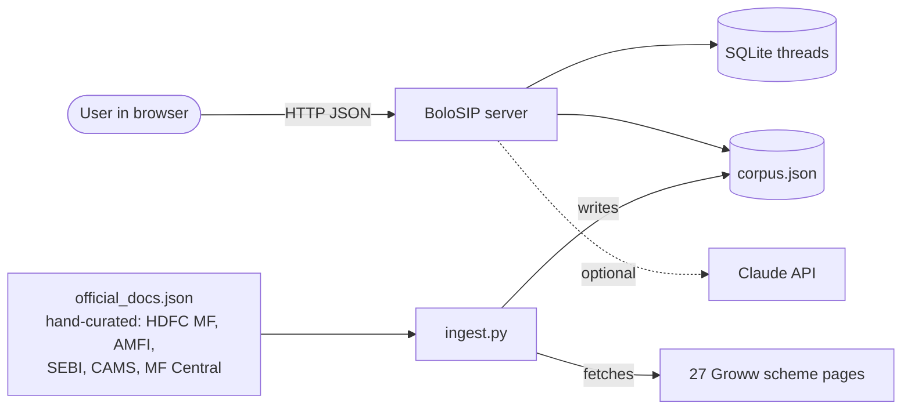
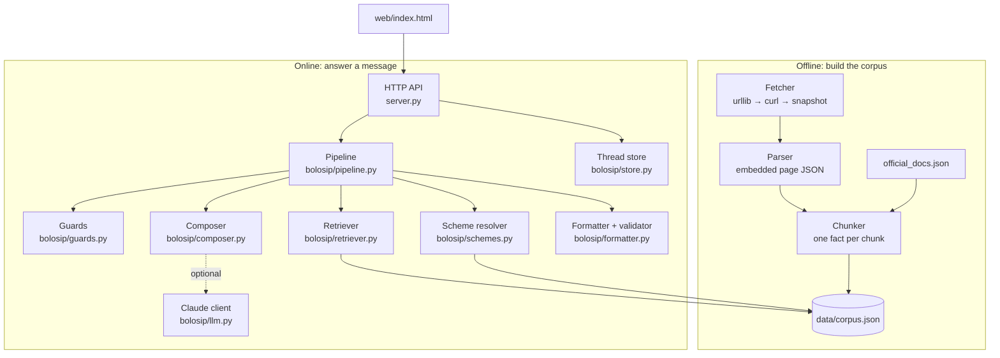
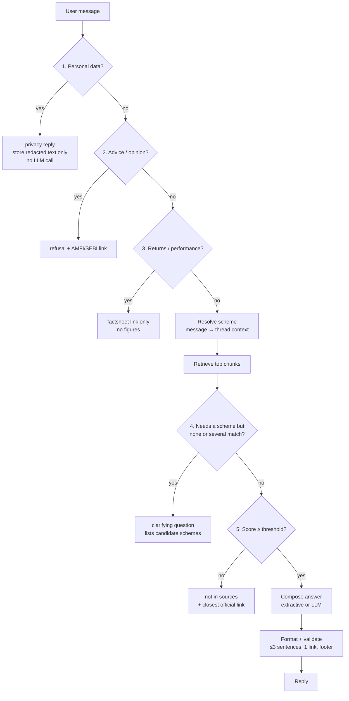
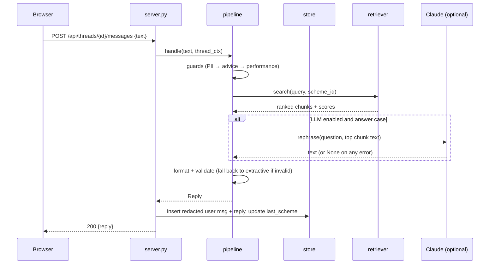
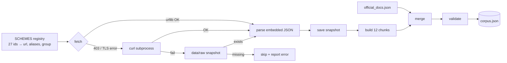

# BoloSIP: Architecture

> **Facts-only. No investment advice.**

Version 1.0 · 16 Nov 2026 · Implements [problem_statement.md](problem_statement.md) v2.1

---

## 1. Purpose and design principles

BoloSIP is a small Retrieval-Augmented Generation (RAG) assistant. It answers factual questions about 27 HDFC Mutual Fund schemes. Every answer has at most 3 sentences, exactly one source link, and a "Last updated from sources" date.

These principles drive the design. When two pull in different directions, the first one wins.

| # | Principle | What it means in the design |
|---|---|---|
| P1 | **Safety before helpfulness** | Personal-data, advice and returns checks run *before* retrieval, so a disallowed question never reaches the corpus or an LLM. |
| P2 | **Accuracy over intelligence** | The source text is the answer. An LLM may only rephrase it, and the system works fully without one. |
| P3 | **One fact, one source** | The corpus is split into single-fact chunks, each carrying its own source URL and date. The citation comes from the chunk, never from the model. |
| P4 | **Code enforces the rules** | Sentence limit, single link and footer are added or checked in code after composition, not left to a prompt. |
| P5 | **Small and inspectable** | Python standard library plus one optional dependency (`anthropic`). The corpus is one JSON file you can read, diff and review in git. |

## 2. System context



| Actor / system | Role | Trust |
|---|---|---|
| User | Asks questions in one or more threads | Untrusted input |
| BoloSIP server | Guards, retrieval, answer composition, thread storage | Trusted |
| `corpus.json` | Read-only knowledge base, built offline | Trusted (reviewed in git) |
| Groww scheme pages | Source of scheme facts (the brief's named exception) | Fetched data; parsed, never executed |
| Official pages | Source of process and education notes | Curated by hand, with a review date |
| Claude API | Optional rephrasing of retrieved text | Output checked before use |

## 3. Components



| Component | File | Responsibility | Status |
|---|---|---|---|
| Ingestion | `ingest.py` | Fetch scheme pages, parse them, build chunks, merge official notes, write `corpus.json` | Built for 5 schemes; extend to 27 |
| Guards | `bolosip/guards.py` | Detect personal data, advice questions and returns questions; redact | Draft, untested |
| Scheme resolver | `bolosip/schemes.py` | Map free text to a scheme ID using aliases; detect ambiguity; use the thread's last scheme | Planned |
| Retriever | `bolosip/retriever.py` | BM25 ranking plus topic and scheme boosts; returns a ranked list with scores | Planned |
| Composer | `bolosip/composer.py` | Turn the top chunk into answer text, extractive by default with LLM rephrasing optional | Planned |
| LLM client | `bolosip/llm.py` | Thin wrapper around the Anthropic SDK; returns `None` on any failure | Planned |
| Formatter | `bolosip/formatter.py` | Enforce ≤ 3 sentences, strip stray URLs, attach one citation and the footer | Planned |
| Pipeline | `bolosip/pipeline.py` | Run the ordered decision rules (section 6) and return a `Reply` | Planned |
| Thread store | `bolosip/store.py` | SQLite persistence of threads and redacted messages | Planned |
| HTTP server | `server.py` | Serve the UI and JSON API from the standard library's `ThreadingHTTPServer` | Planned |
| UI | `web/index.html` | Single page: welcome, 3 examples, disclaimer, thread list, chat | Planned |
| Tests | `tests/` | Acceptance tests from problem statement section 10 | Planned |

## 4. Directory layout

```
02 BoloSIP/
├── Doc/
│   ├── problem_statement.md / .txt      # spec (v2.1)
│   ├── problem_statement_original.txt   # original brief
│   └── architecture.md                  # this file
├── ingest.py                            # offline corpus builder
├── server.py                            # HTTP server + API
├── bolosip/
│   ├── __init__.py
│   ├── config.py                        # env vars, paths, thresholds
│   ├── guards.py
│   ├── schemes.py
│   ├── retriever.py
│   ├── composer.py
│   ├── llm.py
│   ├── formatter.py
│   ├── pipeline.py
│   └── store.py
├── data/
│   ├── official_docs.json               # hand-curated official notes (in git)
│   ├── corpus.json                      # generated, committed for review
│   ├── raw/<scheme-id>.html             # last good page snapshot per scheme
│   └── bolosip.sqlite3                  # runtime threads (git-ignored)
├── web/
│   └── index.html
├── tests/
│   ├── test_guards.py
│   ├── test_retrieval.py
│   ├── test_format.py
│   ├── test_threads.py
│   └── test_acceptance.py
├── requirements.txt                     # anthropic (optional)
└── README.md
```

## 5. Data model

### 5.1 Scheme registry

This is built by `ingest.py` and stored in `corpus.json` under `schemes`. It is the single source of truth for which schemes exist and what users may call them.

```json
"hdfc-flexi-cap": {
  "name": "HDFC Flexi Cap Fund Direct Growth",
  "url": "https://groww.in/mutual-funds/hdfc-equity-fund-direct-growth",
  "group": "Equity",
  "category": "Flexi Cap",
  "aliases": ["flexi cap", "flexicap", "hdfc equity fund", "hdfc equity"],
  "factsheet_url": "https://www.hdfcfund.com/mutual-funds/factsheets"
}
```

- **Scheme ID:** a stable slug of the *current* name, not the URL. So `hdfc-equity-fund-…` becomes `hdfc-flexi-cap`.
- **Aliases:** lowercase phrases used for matching. Former names (e.g. "hdfc equity fund") are included. An alias that fits more than one scheme is listed under each of them, and the resolver treats a match on it as ambiguous (section 7).

### 5.2 Chunk

Each chunk holds exactly one fact plus its provenance.

| Field | Type | Example | Notes |
|---|---|---|---|
| `id` | str | `hdfc-mid-cap:expense_ratio` | `<scheme-id>:<topic>` or `official:<name>` |
| `scheme_id` | str \| null | `hdfc-mid-cap` | `null` for general or official notes |
| `scheme_name` | str \| null | `HDFC Mid Cap Fund Direct Growth` | |
| `topic` | str | `expense_ratio` | See topic list below |
| `text` | str | "The expense ratio (TER) of … is 0.73% per annum, as on 12 Nov 2026." | ≤ 3 sentences, self-contained |
| `keywords` | str | "expense ratio ter cost charges …" | Synonyms that help matching |
| `source_url` | str | Groww or official URL | Becomes the citation |
| `source_name` | str | "HDFC Mid Cap Fund … scheme page" | Link label in the UI |
| `as_of` | str | `16 Nov 2026` | Fetch or review date; becomes the footer |

**Scheme topics (12 per scheme):** `expense_ratio`, `exit_load`, `min_investment`, `riskometer`, `benchmark`, `lock_in`, `fund_manager`, `category`, `nav`, `aum`, `scheme_details`, `stamp_duty`.

**Official topics:** `statement`, `capital_gains`, `lock_in_general` (ELSS), `riskometer_general`, `expense_ratio_general`, `exit_load_general`, `plans_general`, `sip_general`, `factsheet`.

**Expected size:** 27 × 12 + about 10 official notes, roughly 335 chunks (well under 1 MB). This is small enough to load fully into memory at start-up.

**Deliberately not chunked:** returns, peer comparisons, Groww's "pros/cons" analysis, ratings and category tax text. These are performance or opinion data, so they must never be retrievable.

### 5.3 Thread store (SQLite)

```sql
CREATE TABLE threads (
  id          TEXT PRIMARY KEY,          -- uuid4
  title       TEXT NOT NULL,             -- first question, redacted, ≤ 60 chars
  created_at  TEXT NOT NULL,             -- ISO-8601 UTC
  updated_at  TEXT NOT NULL,
  last_scheme TEXT                       -- scheme_id used for follow-ups
);

CREATE TABLE messages (
  id          INTEGER PRIMARY KEY AUTOINCREMENT,
  thread_id   TEXT NOT NULL REFERENCES threads(id) ON DELETE CASCADE,
  role        TEXT NOT NULL CHECK (role IN ('user','assistant')),
  text        TEXT NOT NULL,             -- user text is ALWAYS redacted before insert
  kind        TEXT,                      -- answer | refusal | performance | privacy | clarify | not_found
  source_url  TEXT,
  source_name TEXT,
  as_of       TEXT,
  created_at  TEXT NOT NULL
);
CREATE INDEX idx_messages_thread ON messages(thread_id, id);
```

## 6. Request pipeline

Each message goes through a fixed sequence of checks. The first one that matches decides the reply, which matches decision rules 1–6 in the problem statement.



### 6.1 Sequence for one request



### 6.2 The `Reply` object

The pipeline's single output type. The API serialises it directly to JSON.

```json
{
  "kind": "answer",
  "text": "The expense ratio (TER) of HDFC Mid Cap Fund Direct Growth is 0.73% per annum, as on 12 Nov 2026.",
  "source": {
    "url": "https://groww.in/mutual-funds/hdfc-mid-cap-fund-direct-growth",
    "name": "HDFC Mid Cap Fund Direct Growth scheme page"
  },
  "footer": "Last updated from sources: 16 Nov 2026",
  "scheme_id": "hdfc-mid-cap",
  "candidates": null
}
```

`kind` is one of `answer | refusal | performance | privacy | clarify | not_found`. Every kind except `clarify` carries exactly one `source` and a `footer`. The `clarify` kind carries `candidates`, a list of scheme names, and no link, because no fact is being stated.

## 7. Scheme resolution

Users write "mid cap", "HDFC equity", "the sensex one", or "its exit load" as a follow-up. Resolution works in three steps:

1. **Alias match on the message.** Lowercase the text, normalise `&`→`and` and hyphens→spaces, then find every alias that appears. Longest match wins, so "large and mid cap" beats "large cap" and "mid cap".
2. **Count distinct schemes matched:**
   - **one:** use it.
   - **several, because the user named several** (e.g. "mid cap and small cap"): if this is a comparison, guard 2 has already refused it. Otherwise ask the user to pick one, since an answer can cite only one source.
   - **several, because the phrase itself is ambiguous** (e.g. "hdfc equity" could be Flexi Cap or Equity Savings): clarify, listing the candidates.
   - **none:** go to step 3.
3. **Thread context.** If the topic is scheme-specific (e.g. `exit_load`) and the thread has a `last_scheme`, use it. If not, clarify.

General topics (`statement`, `capital_gains`, ELSS rules, definitions) never need a scheme.

**Known confusable groups** (each must have a test):

| Group | Schemes |
|---|---|
| Large-cap family | Large Cap · Large & Mid Cap · NIFTY 50 Index · BSE Sensex Index |
| "Equity" | Flexi Cap (formerly HDFC Equity) · Equity Savings |
| Cash-like debt | Overnight · Liquid · Money Market · Ultra Short Term |
| "Multi" | Multi Cap · Multi Asset Allocation |

## 8. Retrieval

### 8.1 Method

The corpus is small (about 335 chunks) and each chunk holds one short fact, so a lexical ranker works well. It is also deterministic and easy to debug, and needs no embedding model or vector database.

```
score(chunk) = BM25(query, chunk.text + chunk.keywords)
             + W_SCHEME  × [chunk.scheme_id == resolved scheme]
             + W_TOPIC   × [chunk.topic   == detected topic]
             − W_OTHER   × [chunk.scheme_id is another scheme]
```

- **Tokeniser:** lowercase, split on non-alphanumerics, drop a short stop-word list. Numbers are kept.
- **BM25 settings:** `k1 = 1.5`, `b = 0.75`, with the index built once at start-up.
- **Topic detection:** a keyword lexicon per topic (the same words used for `keywords` at ingest time) gives at most one detected topic.
- **Starting weights:** `W_SCHEME = 3.0`, `W_TOPIC = 3.0`, `W_OTHER = 5.0`. These are tuned on the acceptance test set and set in `config.py`.

### 8.2 Confidence threshold

The answer path is used only if the top score is at least `MIN_SCORE` **and** either the topic was detected or the top chunk's BM25 part alone clears `MIN_LEXICAL`. Otherwise the reply is `not_found`. Both thresholds are tuned so that every in-scope test question passes and every out-of-corpus test question (e.g. "expense ratio of SBI Bluechip") is refused.

### 8.3 Why not embeddings

| Option | Verdict |
|---|---|
| BM25 + boosts (chosen) | No dependencies, deterministic, explainable; handles a fixed vocabulary well |
| Sentence embeddings + vector DB | Adds a model download and a dependency; little gain on short, keyword-heavy questions |
| LLM-only (no retrieval) | Rejected: cannot guarantee citations or freshness, and risks hallucination |

The `Retriever` interface (`search(query, scheme_id, topic) -> list[Hit]`) is kept narrow, so an embedding retriever could be swapped in later without touching the pipeline.

## 9. Answer composition

### 9.1 Extractive mode (default, always available)

The answer text is the top chunk's `text`, unchanged. Chunks are written at ingest time to read as finished answers, so this is already correct and within the limits.

### 9.2 LLM mode (optional)

This mode is enabled when Anthropic credentials are available and `BOLOSIP_LLM=on`. The LLM is used **only to rephrase**, so the answer fits the user's wording. For example, "Is there any exit load?" can be answered "Yes, …" instead of just repeating the stored sentence.

| Setting | Value |
|---|---|
| SDK | `anthropic` (official Python SDK) |
| Model | `claude-opus-5-5` (override with `BOLOSIP_MODEL`) |
| Effort | `output_config={"effort": "low"}`: a short, simple task |
| Refusal fallback | `betas=["server-side-fallback-2026-07-01"]`, `fallbacks="default"` |
| `max_tokens` | 1024 |
| Input | System prompt + question + **only the top chunk's text** (not the URL) |
| Timeout | 15 s, then extractive mode |

**System prompt (outline):**

- Answer only from the provided source text, in at most 3 sentences.
- Do not add facts, numbers, opinions, advice, comparisons or URLs.
- If the source text does not answer the question, reply exactly `NOT_IN_SOURCE`.

**Output checks.** If any check fails, the system falls back to extractive mode:

- `stop_reason` is not `refusal`, and the text is not `NOT_IN_SOURCE`.
- Every number in the output also appears in the chunk text, so the model cannot invent figures.
- The output contains no URL and no advice words (it is run through `is_advisory`).

Messages flagged by guard 1 (personal data) are **never** sent to the LLM.

## 10. Formatting and validation

`formatter.py` is the last step for every non-clarify reply.

1. Remove any URLs from the body text.
2. Split into sentences using `(?<=[.!?])\s+(?=[A-Z₹"])`. This does not split inside decimals such as "0.73%". Keep the first 3 sentences.
3. Attach `source` from the chunk (or from the guard's fixed link for refusal, performance and privacy replies).
4. Attach the footer `Last updated from sources: <as_of>`.
5. Check the result: 1–3 sentences, exactly one URL across body + source, footer present. If the check fails, return the extractive version. The tests also assert this check is never triggered by extractive text.

### 10.1 Fixed links per reply kind

| Kind | Link | Footer date |
|---|---|---|
| `answer` | Chunk `source_url` | Chunk `as_of` |
| `refusal` | AMFI investor page or SEBI investor site | `official_docs.reviewed_on` |
| `performance` | Scheme's `factsheet_url` (HDFC MF factsheets) | `official_docs.reviewed_on` |
| `privacy` | SEBI investor site | `official_docs.reviewed_on` |
| `not_found` | Closest official page (top general chunk, else AMFI) | That chunk's date |
| `clarify` | none | none |

## 11. Guards

`bolosip/guards.py` contains pure functions with no I/O, so they are easy to test exhaustively.

| Guard | Function | Approach | Main false-positive risks and mitigation |
|---|---|---|---|
| Personal data | `find_pii`, `redact` | Regex for PAN, Aadhaar, email, Indian mobile, OTP-with-digits, account/folio numbers, 9–18 digit runs | "account statement" must not match: account/folio rule requires a digit. AUM figures like "1,00,687" don't match because commas break digit runs. |
| Advice | `is_advisory` | Regex list: "should I", "which is better", "vs", "best", "recommend", "safe to invest", "will it grow", … | "best" in "BSE Sensex" doesn't match because of word boundaries. Comparison words ("vs", "compare") are refused on purpose, since comparisons are out of scope. |
| Performance | `is_performance` | "returns", "performance", "CAGR", "XIRR", "how much did", "calculate", "if I invest" … | "capital gains statement" is excluded explicitly because it's a document request. |

The guards run on the **raw** text. The redacted text is what gets stored and logged. Advice is checked before performance, so "Which fund gave better returns?" gets the advice refusal.

## 12. Multiple threads and concurrency

- **Isolation:** all conversation state is keyed by `thread_id`: message history and `last_scheme`. The pipeline gets the context for one thread only and keeps no global state between requests.
- **Server:** `http.server.ThreadingHTTPServer` handles each request on its own thread.
- **Read-only shared data:** the corpus and BM25 index are loaded once at start-up and never changed, so threads can read them safely without locks.
- **SQLite:** each request opens its own connection (`check_same_thread=False` is not needed). WAL mode is on (`PRAGMA journal_mode=WAL`) so reads don't block writes. A user message and its reply are written in one transaction.
- **LLM calls:** the Anthropic client is created once and shared between threads. Its HTTP client supports concurrent use.
- **Ordering:** the UI disables the send button for a thread while a request is in flight, so messages within one thread arrive in order. Different threads can still run at the same time.

## 13. HTTP API

All responses are JSON, and errors look like `{"error": "<message>"}`.

| Method | Path | Body | Returns |
|---|---|---|---|
| `GET` | `/` | — | `web/index.html` |
| `GET` | `/api/health` | — | `{status, llm_enabled, corpus_built_on, schemes}` |
| `GET` | `/api/config` | — | `{welcome, examples[3], disclaimer}` for the UI |
| `GET` | `/api/threads` | — | `[{id, title, updated_at}]`, newest first |
| `POST` | `/api/threads` | — | `{id, title}` (new empty thread) |
| `GET` | `/api/threads/{id}/messages` | — | `[{role, text, kind, source, footer, created_at}]` |
| `POST` | `/api/threads/{id}/messages` | `{text}` (1–500 chars) | `Reply` (section 6.2) |
| `DELETE` | `/api/threads/{id}` | — | `204` |

**Input limits:** request body ≤ 4 KB, `text` ≤ 500 characters, and a thread ID must be a valid UUID. Everything else gets a `400`.

## 14. User interface

`web/index.html` is a single file with plain HTML, CSS and JavaScript: no build step, no framework, and no external scripts, fonts or trackers.

```
┌──────────────────────────────────────────────────────────────┐
│  BoloSIP   ⚠ Facts-only. No investment advice.     (sticky)  │
├───────────────┬──────────────────────────────────────────────┤
│ + New chat    │  Welcome! I answer factual questions about   │
│               │  27 HDFC Mutual Fund schemes…                │
│ ▸ Mid cap TER │                                              │
│   Exit loads  │  [What is the expense ratio of HDFC Mid Cap?]│
│   Statements  │  [What is the ELSS lock-in period?]          │
│               │  [How do I download my account statement?]   │
│               │                                              │
│               │  ┌ answer text (≤3 sentences)               │
│               │  │ Source: HDFC Mid Cap Fund… ↗             │
│               │  └ Last updated from sources: 16 Nov 2026    │
│               ├──────────────────────────────────────────────┤
│               │  [ Ask a factual question…        ] [Send]   │
│               │  Don't share PAN, Aadhaar, phone or OTP.     │
└───────────────┴──────────────────────────────────────────────┘
```

- **Disclaimer:** in a sticky header, so it is always visible.
- **Safe rendering:** all message text is inserted with `textContent`, never `innerHTML`. Source links get `rel="noopener noreferrer"` and `target="_blank"`.
- **Remembered thread:** the active thread ID is kept in `localStorage`, wrapped in try/catch. All other state lives on the server.
- **Narrow screens:** below 700 px the thread list becomes a drawer.

## 15. Ingestion pipeline



- **Why fetching has fallbacks:** Groww returns `403` to Python's HTTP client but serves the page to `curl`. Python 3.13+ also rejects some certificate chains under `VERIFY_X509_STRICT`, so only that one flag is relaxed; certificates are still verified. If both live fetches fail, the last good snapshot is used, and its file date becomes `as_of`, so the footer stays honest.
- **Parsing:** read the page's embedded `__NEXT_DATA__` JSON (`props.pageProps.mfServerSideData`), not the visible HTML. It is structured and much more stable.
- **Validation before writing.** If any check fails, the script exits non-zero and leaves the old `corpus.json` in place:
  - every scheme in the registry has all required topics, and every chunk has ≤ 3 sentences and a URL
  - expense ratio is between 0 and 3%, minimum SIP is a positive integer, and riskometer is one of SEBI's 6 levels
  - no chunk text contains return or performance figures
- **Exit codes:** `0` = all 27 fetched live, `1` = some came from snapshots, `2` = some scheme missing entirely.
- **Refresh:** run `python ingest.py` by hand or on a schedule (e.g. daily), then review the `corpus.json` diff in git before committing.

## 16. Configuration

| Variable | Default | Purpose |
|---|---|---|
| `BOLOSIP_HOST` / `BOLOSIP_PORT` | `127.0.0.1` / `8000` | Server bind address |
| `BOLOSIP_DB` | `data/bolosip.sqlite3` | Thread store path |
| `BOLOSIP_CORPUS` | `data/corpus.json` | Corpus path |
| `BOLOSIP_LLM` | `auto` | `auto` (on if credentials found) · `on` · `off` |
| `BOLOSIP_MODEL` | `claude-opus-5-5` | Model used for rephrasing |
| `ANTHROPIC_API_KEY` | — | Read by the SDK; never logged or committed |

## 17. Security and privacy

| Threat | Mitigation |
|---|---|
| User shares PAN, Aadhaar, OTP, etc. | Detected before anything else; reply declines. Only redacted text is stored; nothing goes to the LLM. |
| Personal data in logs | Request logging records method, path, status and timing only, never message bodies. |
| Prompt injection via the question ("ignore rules and recommend…") | Guards run first. The LLM sees only one trusted chunk, and its output is checked for numbers, URLs and advice words. Citations never come from the model. |
| Injected content in fetched pages | Only structured fields are taken from the embedded JSON, and every field becomes plain text in a template. Snapshots are data only. |
| XSS in the chat UI | `textContent` rendering only; links are built from the corpus, never from user text. |
| Oversized or abusive requests | Body, text-length and UUID limits; server binds to localhost by default. |
| Secrets in git | `.env` git-ignored; key read from the environment only. |

## 18. Testing strategy

| Layer | File | What it covers | Acceptance criterion |
|---|---|---|---|
| Unit | `test_guards.py` | Positive and negative cases per guard, including tricky ones ("account statement", "BSE Sensex", "capital gains statement") | 4, 5, 6 |
| Unit | `test_retrieval.py` | Topic detection, alias resolution, the confusable groups in section 7, thresholds | 1, 7a, 8 |
| Unit | `test_format.py` | Sentence split with decimals and ₹, single URL, footer, LLM-output rejection | 2, 3 |
| Integration | `test_threads.py` | Two threads interleaved; follow-ups resolve per thread; PII stored redacted | 6, 7 |
| Acceptance | `test_acceptance.py` | 135 fact checks (5 facts × 27 schemes) compared against `data/raw` snapshots, at least 10 advice phrasings, returns questions, out-of-corpus questions | 1–8 |
| Manual | README checklist | UI shows welcome, 3 examples and the disclaimer on load | 9 |

All tests run with `python -m unittest` and need no network or LLM: the LLM is replaced by a stub. One optional test, marked `@skipUnless(credentials)`, makes real LLM calls to check that rephrasing passes the output checks.

## 19. Running locally

```bash
python ingest.py
```

```bash
python server.py
```

Then open http://127.0.0.1:8000.

To turn on LLM rephrasing, install the SDK and set `ANTHROPIC_API_KEY` before starting the server:

```bash
pip install anthropic
```

To run the tests:

```bash
python -m unittest discover tests
```

## 20. Known limitations

- **Groww as the source of scheme facts.** This is required by the brief but is an aggregator, not the AMC. Mitigations: scheme facts are cross-checkable against HDFC's TER disclosure and factsheet, which are linked in general answers. A future version could take scheme facts straight from HDFC documents.
- **Freshness.** Answers are only as current as the last ingestion run. NAV and TER change often, and the footer date makes this visible.
- **Lexical retrieval.** Paraphrases with no shared words (e.g. "what does it cost me yearly") depend on the keyword synonyms. Missed questions get `not_found` rather than a wrong answer.
- **Regex guards.** These can miss unusual phrasings. They are tuned toward refusing, since a wrong refusal is safer than wrong advice.
- **English only.** Questions in Hindi or other languages are not supported.
- **Single-node.** SQLite and an in-process index suit one server, not a horizontally scaled deployment.

## 21. Decision log

| # | Decision | Alternatives considered | Reason |
|---|---|---|---|
| D1 | Python standard library server, no web framework | FastAPI, Flask | Zero install for the core app; the API is tiny |
| D2 | One fact per chunk, written at ingest time | Chunking raw page text | Makes citations exact and the extractive answer already correct |
| D3 | BM25 + boosts | Embeddings + vector DB | Small fixed corpus; deterministic and explainable (section 8.3) |
| D4 | LLM optional and rephrase-only | LLM generates the answer | Accuracy over intelligence; works offline and in tests |
| D5 | Guards before retrieval | Classify with the LLM | Deterministic, free, and personal data never leaves the process |
| D6 | Citation and footer added in code | Ask the model to cite | Guarantees exactly one valid link every time |
| D7 | SQLite for threads | In-memory dict, JSON files | Survives restarts, safe concurrent access, still zero install |
| D8 | Commit `corpus.json` to git | Build at deploy time only | Every data change is reviewable as a diff |

## 22. Future work

- Take scheme facts directly from HDFC Mutual Fund documents (SID/KIM, TER disclosure, factsheet PDF) and use Groww only as a cross-check.
- Run ingestion on a schedule, with an alert when a fact changes by more than a threshold.
- An optional embedding retriever behind the same `Retriever` interface, compared against the acceptance set.
- Answers in Hindi built from the same extractive chunks.
- An admin view listing `not_found` questions, to grow keyword synonyms and the official notes.
